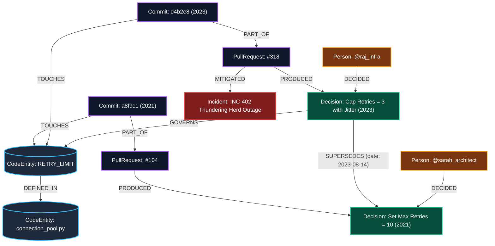

# WhyTrace: Temporal Decision Graph Engine for Codebases
### HackFront 2026 — Theme T1: AI & Developer Tools (PS T1.1)
**Track:** Best Use of Neo4j AuraDB | **Build Type:** Applied AI & GraphRAG

---

## 1. Executive Summary & Winning Thesis

In software engineering, code records **what** is happening, but never **why**. 
When senior engineers leave, their institutional memory—buried in commit messages, closed PR arguments, post-incident war-rooms, and architectural RFCs—departs with them.

Current developer assistants rely on **naive vector embeddings**. They fail catastrophically because:
1. **Vector search is blind to temporal validity**: It matches on semantic keywords. A superseded 2021 design doc often outranks the quiet 2024 PR that reversed it.
2. **Vector search cannot detect entity evolution**: When `transport/pool.py` is renamed to `core/connection_manager.py`, vector chunks lose historical continuity.
3. **LLMs hallucinate missing intent**: When asked about an arbitrary constant with zero recorded rationale, LLMs fabricate a plausible explanation.

**WhyTrace** proves that **the value sits in the relationships, and the graph is doing the work**:
- **Temporal Supersession Graph Traversal**: Detects dead decisions using `[:SUPERSEDES*]` relationship chains in Neo4j.
- **Topological Confidence Metric**: A mathematical certainty score calculated purely from graph connectivity ($C_{graph} \in [0, 1]$). If $C < 0.35$, the system refuses to guess and alerts the developer.
- **Entity Resolution over Renames**: Follows `[:RENAMED_TO*]` edges across years of git refactoring.
- **Side-by-Side "Head-to-Head" Proof**: A live interactive comparison exposing how vector search provides obsolete answers while WhyTrace retrieves the verified active decision chain.

---

## 2. Graph Ontology (Neo4j Schema)



### Node Types
- `(:CodeEntity {id, name, type, path, aliases})`: Represents files, functions, constants, or modules.
- `(:Decision {id, summary, rationale, timestamp, status})`: An explicit choice made during development.
- `(:Commit {sha, message, timestamp, author})`: Git commit records.
- `(:PullRequest {number, title, body, merged_at, url})`: GitHub/GitLab PRs.
- `(:Issue {number, title, body, state, closed_at})`: Bug or feature issue.
- `(:Incident {id, title, severity, summary, date})`: Production incidents/post-mortems.
- `(:Person {id, name, handle, role, is_active})`: Engineers and reviewers.

### Key Relationships
- `(Decision)-[:SUPERSEDES {date, reason}]->(Decision)`: The temporal override edge.
- `(CodeEntity)-[:RENAMED_TO {date, commit}]->(CodeEntity)`: Historical refactoring lineage.
- `(PullRequest)-[:MITIGATED]->(Incident)`: Causal tie between production pain and code change.
- `(Decision)-[:GOVERNS]->(CodeEntity)`: Active scope of governance.

---

## 3. The 3 Differentiators That Win the Neo4j Track

### 1. The Supersession Engine (Cypher Traversal)
```cypher
MATCH (target:CodeEntity) WHERE target.name = $entity_name OR $entity_name IN target.aliases
MATCH (target)<-[:GOVERNS|TOUCHES*1..3]-(d:Decision)
OPTIONAL MATCH (newer:Decision)-[:SUPERSEDES*1..5]->(d)
WITH d, collect(newer) as superseding_decisions
RETURN d.id AS decision_id,
       d.summary AS summary,
       d.status AS status,
       d.timestamp AS date,
       CASE WHEN size(superseding_decisions) > 0 THEN 'SUPERSEDED' ELSE 'ACTIVE' END AS calculated_status,
       [x IN superseding_decisions | {id: x.id, summary: x.summary, date: x.timestamp}] AS overridden_by
ORDER BY d.timestamp DESC
```
**Why this wins**: The model doesn't guess if the decision is valid. The graph proves it deterministically.

### 2. Topological Confidence Metric
Instead of asking an LLM "How sure are you?", WhyTrace computes confidence directly from graph topology:
$$C = \min\left(1.0, \; 0.35 \cdot \mathbb{I}(\text{Decision}) + 0.25 \cdot \mathbb{I}(\text{PR}) + 0.20 \cdot \mathbb{I}(\text{Incident}) + 0.10 \cdot \mathbb{I}(\text{Active Reviewer}) + 0.10 \cdot \mathbb{I}(\text{Unsuperseded})\right)$$
If $C < 0.35$ (e.g. only an orphan commit exists), the system issues a **Refusal Alert** with 0% speculation.

### 3. Entity Resolution Across Time
Handles renamed modules like:
`src/net/http_client.py` -> `pkg/transport/client.py` -> `internal/conn/manager.go`.

---

## 4. Live Demo Flow for Judges (3-Minute Tour de Force)

1. **Test Case 1: The Outage Override (Supersession Demo)**
   - Query: *"Why is the connection pool retry limit set to 3?"*
   - Naive Vector Search Output: *"Retries are set to 10 to ensure resilience across network blips (Architecture RFC 2021)."* ❌
   - **WhyTrace Neo4j Output**: *"Active Limit: 3. The 2021 policy (10 retries) was SUPERSEDED on 2023-08-14 in PR #318 by @raj_infra after Incident INC-402 (Thundering herd outage crashed downstream DB)."* ✅

2. **Test Case 2: The Refactoring Trace (Entity Resolution Demo)**
   - Query: *"Why did we remove keep-alive timeouts in `connection_manager.py`?"*
   - WhyTrace automatically traverses `[:RENAMED_TO]` back to `transport/pool.py` from 2022 and surfaces the underlying issue.

3. **Test Case 3: The Honest Refusal (Anti-Hallucination Demo)**
   - Query: *"Why is `MAGIC_BUFFER_SIZE` set to 1460 in socket_reader.py?"*
   - WhyTrace Output: **`Confidence: 15% — REFUSAL`**. Shows that it was committed directly to main by an ex-engineer without PR discussion, RFC, or incident link. Refuses to make up a story.

