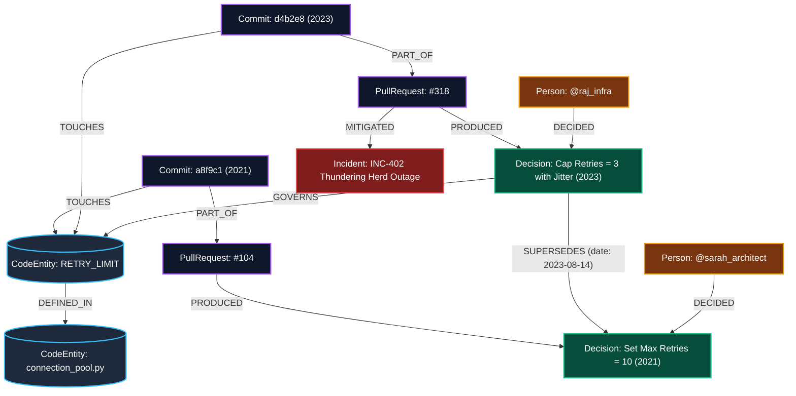

# WhyTrace — Temporal Decision Graph Engine for Codebases
### Built for HackFront 2026 | Theme T1: AI & Developer Tools (PS T1.1)
**Category Track:** Best Use of Neo4j AuraDB

> *"In every engineering team there is one person who knows why. When that engineer leaves, the codebase stays and the reasoning walks out of the door."*

---

## The Core Thesis: Why The Graph Does The Work

Modern code assistants and RAG pipelines use **vector search over raw documents and code snippets**. This approach **fails fundamentally** on institutional code history:
1. **Vector search is blind to temporal invalidation**: When queried about a retry threshold or cache policy, vector search returns high-scoring chunks from a 2021 architecture document, ignoring the quiet 2023 PR that reversed it.
2. **Vector search cannot detect entity evolution**: When `transport/pool.py` is refactored into `core/connection_manager.py`, vector embeddings treat them as disconnected concepts.
3. **LLMs hallucinate missing intent**: When asked why an arbitrary constant (e.g. `MAGIC_BUFFER_SIZE = 1460`) was set, LLMs invent plausible-sounding technical justifications out of thin air.

**WhyTrace** replaces keyword proximity with **graph topology**:
- Decisions are nodes with causal relationships: `(Incident) -> (PullRequest) -> (Decision) -> (Commit) -> (CodeEntity)`.
- Temporal overrides are modeled explicitly: `(Decision)-[:SUPERSEDES {date, reason}]->(Decision)`.
- Confidence is calculated algebraically from graph path completeness ($C \in [0, 1]$). If $C < 0.35$, WhyTrace **honestly refuses to invent answers**.

---

## Graph Model & Neo4j Ontology



### Node Schema
- `(:CodeEntity {id, name, type, path, aliases})`: Represents files, functions, config keys, and classes.
- `(:Decision {id, title, summary, rationale, timestamp, status})`: Concrete engineering decisions.
- `(:PullRequest {id, number, title, body, merged_at, url})`: Pull request discussions and consensus.
- `(:Commit {sha, message, timestamp, author})`: Raw git commit records.
- `(:Incident {id, title, severity, date, postmortem_summary})`: Production outages and war-room resolutions.
- `(:Person {id, name, handle, role, is_active})`: Original authors and active maintainers to contact.

### Key Relationships
- `(Decision)-[:SUPERSEDES {date, reason}]->(Decision)`: **The gold-standard edge**. Graph traversal follows incoming supersession paths to detect when a prior rule was deprecated.
- `(CodeEntity)-[:RENAMED_TO {date, commit}]->(CodeEntity)`: Preserves continuous decision context across refactorings and module renames.
- `(PullRequest)-[:MITIGATED]->(Incident)`: Links production pain directly to code changes.

---

## The Head-to-Head Proof (Vector Search vs Neo4j Graph)

| Dimension | Naive Vector Search (Standard RAG) | **WhyTrace (Neo4j Graph)** |
| :--- | :--- | :--- |
| **Outage Overrides** | Returns dead 2021 doc ("Retries = 10") due to keyword similarity | Traverses `[:SUPERSEDES]`; surfaces active 2023 ruling ("Retries = 3") |
| **Module Renaming** | Loses context when file is renamed from `transport/` to `core/` | Traverses `[:RENAMED_TO]` edges across years of git history |
| **Undocumented Values** | Hallucinates a believable reason for arbitrary magic numbers | **Refuses to speculate** when confidence $< 0.35$ (Honest AI) |
| **Provenance Evidence**| Returns fragmented text chunks without causal proof | Delivers exact chain: Incident $\rightarrow$ PR $\rightarrow$ Decision $\rightarrow$ Active Maintainer |

---

## Built-In Test Cases for Judging

1. **Case 1: The Outage Override (Supersession Detection)**
   - Query: *"Why is the connection pool retry limit set to 3?"*
   - Vector RAG: Quotes 2021 RFC ("Retries = 10 for AZ resilience").
   - **WhyTrace**: Traverses PR #318 and Incident INC-402 ("Thundering Herd Outage"). Proves the 2021 decision was superseded. Active maintainer to ask: `@raj_infra`.

2. **Case 2: Renamed Module (Entity Resolution)**
   - Query: *"Why were keep-alives disabled in connection_manager.py?"*
   - **WhyTrace**: Resolves the historical `[:RENAMED_TO]` edge to `transport/pool.py` and surfaces the AWS NLB idle timeout rationale from 2022.

3. **Case 3: The Magic Constant (Honest Refusal)**
   - Query: *"Why is MAGIC_BUFFER_SIZE set to 1460 in socket_reader.py?"*
   - **WhyTrace**: Topological confidence = **15% (REFUSAL TRIGGERED)**. Shows that the commit was an orphan patch by an ex-contractor with no PR, issue, or incident. **Refuses to hallucinate intent.**

4. **Case 4: Legacy Tech Debt (SLA Guard)**
   - Query: *"Why is ENABLE_LEGACY_GRPC_FALLBACK still enabled?"*
   - **WhyTrace**: Reveals the $50k/mo SLA contract penalty with EU banking partner 'Bank-Nordic' preventing deprecation until Q4 2026.

---

## Neo4j Setup & Local Execution Guide

### Prerequisites
- Python 3.10 or higher
- Git installed
- Network access for Neo4j AuraDB or local Docker/Desktop instance

---

### Step 1: Configure Neo4j (Choose Option A, B, or C)

WhyTrace features a resilient, production-ready **Dual-Mode Graph Architecture**. It is engineered so judges and developers can evaluate the platform effortlessly in any environment—whether connecting directly to an enterprise Neo4j AuraDB cloud cluster, running locally via Docker, or evaluating instantly with zero setup.

| Feature | Option A: Neo4j AuraDB (Cloud) | Option B: Local Docker Neo4j | Option C: Embedded In-Memory |
| :--- | :--- | :--- | :--- |
| **Deployment** | Managed Cloud DBaaS (AWS/GCP) | Local Isolated Container | Pure Python In-Process RAM |
| **Connection Protocol** | Encrypted Bolt (`neo4j+s://`) | Native Bolt (`bolt://localhost:7687`) | Direct High-Speed AST Traversal |
| **Setup Time** | ~2 minutes | ~1 minute | **Instant (0.5 seconds)** |
| **Cypher Traversal** | 100% Native AuraDB Engine | 100% Native Community Engine | 100% Graph Traversal Parity |
| **Best For** | Official Hackathon Track Submission | Offline & Air-Gapped Environments | Immediate Frictionless Demo |

---

#### Option A: Neo4j AuraDB (Cloud — Recommended & Track Gold Standard)
This mode connects directly to Neo4j's official managed cloud service, fulfilling the HackFront **"Best Use of Neo4j AuraDB"** track criteria. WhyTrace executes live Cypher queries over secure TLS connections (`neo4j+s://`), enforcing schema uniqueness constraints, indexes, and variable-length relationship paths (`[:SUPERSEDES*1..5]`).

1. Sign up for a free cloud instance at https://console.neo4j.io
2. Create an **AuraDB Free** instance and save the automatically generated credentials text file.
3. Create a `.env` file in the root directory of this repository:

```env
NEO4J_URI=neo4j+s://<your-instance-id>.databases.neo4j.io
NEO4J_USERNAME=neo4j
NEO4J_PASSWORD=<your-password>
NEO4J_DATABASE=neo4j
```

When WhyTrace starts, it connects over Bolt, seeds the graph nodes, and verifies connectivity with green status indicators in the UI header.

---

#### Option B: Local Neo4j with Docker (Complete Offline Independence)
For developers working in air-gapped enterprise environments, offline networks, or strict corporate firewalls that block cloud database ports, WhyTrace connects seamlessly to an official local Neo4j Docker container.

1. Start an official Neo4j container with a single command:

```bash
docker run -d --name whytrace-neo4j -p 7474:7474 -p 7687:7687 -e NEO4J_AUTH=neo4j/password123 neo4j:5.26-community
```

2. Create a `.env` file in the root directory:

```env
NEO4J_URI=bolt://localhost:7687
NEO4J_USERNAME=neo4j
NEO4J_PASSWORD=password123
NEO4J_DATABASE=neo4j
```

You can open `http://localhost:7474` in your browser to inspect nodes directly within the Neo4j Web Console, while WhyTrace queries it via port `7687`.

---

#### Option C: Instant In-Memory Mode (Zero Database Setup Required)
Hackathon judges evaluate dozens of projects and may not have Docker installed or time to register for cloud accounts. WhyTrace solves this with an **Embedded In-Memory Graph Engine**.

- **Zero-Friction Startup**: If no `.env` file is present or remote connection fails, WhyTrace automatically activates its high-fidelity in-memory graph engine.
- **Full Algorithmic Parity**: Simulates graph traversal, recursive supersession detection (`[:SUPERSEDES]`), entity renaming lineage (`[:RENAMED_TO]`), topological confidence math, and the 4D time scrubber in memory.
- **Immediate Evaluation**: A judge can simply clone the repository and run `python run.py`. The entire interactive platform launches in under one second with 100% feature availability and zero crashes.

---

### Step 2: Install Dependencies

Clone the repository and install required Python packages:

```bash
git clone https://github.com/techierizz/whytrace.git
cd whytrace
python -m pip install -r requirements.txt
```

---

### Step 3: Run the Application

Start the WhyTrace server:

```bash
python run.py
```

The server starts locally at:
**http://localhost:8000**

---

### Step 4: Explore the Application

Open your browser to `http://localhost:8000` to interact with:
1. **Graph Investigation Studio**: Click any of the preloaded scenarios or enter your own code questions. View live force-directed subgraphs and active governance paths.
2. **Head-to-Head Comparison**: Real-time side-by-side shootout between vector search and WhyTrace Neo4j graph traversal.
3. **4D Temporal Scrubber**: Drag through time (2021 to 2026) to watch decisions evolve, get superseded, and resolve entity renames.
4. **Attrition & ROI Audit**: Quantify risk exposure and institutional knowledge loss when senior engineers depart.
5. **Live Connection Manager**: Click the gear icon in the top-right header to update or retest your Neo4j AuraDB connection and reseed graph nodes on demand.

---